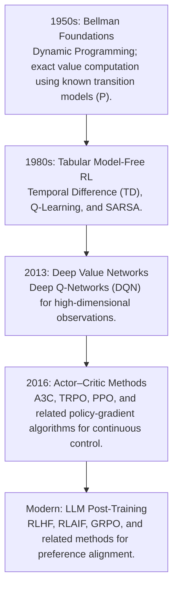
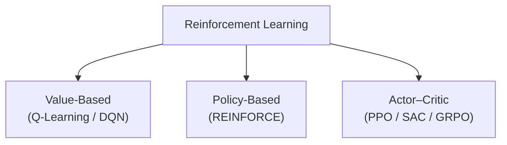

<<<<<<< HEAD
# Awesome-Reinforcement-Learning

=======
<div align="center">
  
</div>

# 🚀 Awesome-Reinforcement-Learning 🧠
## 🤖 The Reinforcement Learning (RL) Paradigm & Architecture Map 🗺️

<p align="center">
<a href="https://github.com/ishandutta2007/Awesome-Awesome-Awesome"></a><a href="https://discord.gg/jc4xtF58Ve"></a><a href="https://github.com/ishandutta2007"></a>
</p>

**Keywords:** Reinforcement Learning, RL, Machine Learning, AI, Deep Learning, Q-Learning, PPO, Deep Q-Networks, Artificial Intelligence, Neural Networks

> **A comprehensive reference guide for Reinforcement Learning—mapping fundamental mathematical principles, historical algorithmic lineages, deep neural extensions, and multi-agent systems.**

Reinforcement Learning focuses on training autonomous software agents to maximize cumulative rewards within a dynamic environment through sequential trial-and-error. Guided by feedback from actions rather than explicit supervision, RL maps environmental states directly to optimal behaviors.

---

## 📅 The Evolutionary Timeline

The transition of the paradigm from theoretical statistical control equations to highly scalable deep neural networks and self-play models.



---

## 🧭 Deep Dive: Algorithmic Taxonomy & Evolution

### 🏛️ 1. Model-Based vs. Model-Free Architectures
The foundational structural fork in reinforcement learning relies on whether the algorithm constructs or expects an explicitly calculated model of environment physics.

#### Model-Based RL (e.g., Dyna-Q, AlphaZero, MuZero)
The agent leverages or learns a transition function \(P(s' \mid s, a)\) and a reward function R(s, a) to internally simulate scenarios before physically interacting with the environment.
*   **Advantage:** Extremely sample efficient; can safely calculate risks via look-ahead planning or tree searches (MCTS).
*   **Vulnerability:** Severely limited by model inaccuracies; if the internal simulator contains systematic errors, the agent's calculations degrade rapidly (Compounding Model Error).

#### Model-Free RL (e.g., Q-Learning, DQN, PPO)
The agent completely bypasses modeling environmental physics, optimizing its behaviors directly from empirical samples of raw interaction histories.
*   **Advantage:** Flexible and robust across systems that are mathematically chaotic or impossible to model explicitly.
*   **Vulnerability:** Highly sample inefficient; often requires millions of sequential simulation steps to learn stable boundaries.

---

### ⚖️ 2. Value-Based, Policy-Based, and Actor-Critic Methods



#### Value-Based Methods (Tracking Expected Gains)
These algorithms isolate and track the maximum expected long-term return for states or state-action configurations, deriving the optimal policy implicitly by executing greedy actions toward the highest mathematical value.
*   **Core Update Equation (Tabular Q-Learning):**
    \[Q(s, a) \leftarrow Q(s, a) + \alpha \left[ R(s, a) + \gamma \max_{a'} Q(s', a') - Q(s, a) \right]\]
*   **Evolutionary Leap (DQN, 2015):** Replaced lookup matrices with deep convolutional neural networks. Used an **Experience Replay Buffer** to eliminate temporal data dependency and a **Target Network** to freeze gradient fluctuations during training updates.

#### Policy-Based Methods (Direct Mapping)
These methods bypass calculating state-value utilities completely, parameterizing the policy network (\(\pi_\theta(a \mid s)\)) directly to emit an explicit action probability distribution.
*   **Core Objective Equation (REINFORCE / Policy Gradient):**
    \[\nabla_\theta J(\theta) = \mathbb{E} \left[ \nabla_\theta \log \pi_\theta(a \mid s) \cdot G_t \right]\]
    Where \(G_t\) is the total discounted return of the trajectory.
*   **Limitation:** High variance. A single extremely lucky or catastrophic sample can destabilize gradient optimizations.

#### Actor-Critic Implementations (The Modern Synthesis)
Combines the strengths of both frameworks into an asymmetric layout.
1.  **The Actor:** Manages the policy network \(\pi_\theta(a \mid s)\), deciding which specific actions to execute.
2.  **The Critic:** Manages a value network \(V_\phi(s)\), evaluating the quality of the action picked by the Actor to calculate an **Advantage Score** (A(s, a) = Q(s,a) - V(s)).

*   **Evolutionary Edge (Proximal Policy Optimization - PPO, 2017):** Stabilized deep actor-critic gradients by clipping policy updates within a safe ratio window (\([1-\epsilon, 1+\epsilon]\)), preventing networks from falling into catastrophic optimization cliffs.
*   **Evolutionary Edge (Group Relative Policy Optimization - GRPO, 2024-2026 Era):** Streamlined large-scale language model post-training by completely dropping the Critic network. Instead, it generates a group of outputs for a single prompt and calculates advantages relative to the average score of that group, radically shrinking VRAM overhead.

---

## 🧮 Mathematical Foundations (The MDP) 🎲

The entire reinforcement learning universe maps down to a formal mathematical vehicle called the **Markov Decision Process (MDP)**, governed by the Markov Assumption: *The future depends only upon the present state, not the past.*

An MDP is explicitly defined by a 5-tuple: \(\langle S, A, P, R, \gamma \rangle\):
*   S: The total finite space of all valid environmental states.
*   A: The complete array of all possible action vectors available to the agent.
*   P: The transition probability matrix: \(P(s' \mid s, a) = \mathbb{P}(S_{t+1}=s' \mid S_t=s, A_t=a)\).
*   R: The explicit scalar reward function: \(R(s, a) = \mathbb{E}[R_{t+1} \mid S_t=s, A_t=a]\).
*   γ: The structural reward discount factor (0 ≤ γ < 1) prioritizing short-term gains over distant future gains.

---

## 🌍 Real-World Applications by Implementation Domain 🚀

*   **Generative AI Alignment (LLMs):** Utilizing PPO and GRPO protocols to fine-tune pre-trained language architectures based on human preference tokens (RLHF), eliminating hallucinations and toxic outputs while scaling coding competencies.
*   **Industrial Robotics & Autonomous Control:** Utilizing Soft Actor-Critic (SAC) to govern continuous motor control paths, enabling multi-joint robot arms or bipedal systems to dynamically adapt to shifting real-world terrain frictions.
*   **Quantitative Trading Systems:** Applying Deep Deterministic Policy Gradients (DDPG) to orchestrate live stock/crypto portfolio rebalancing schemas based on continuous reward signals tracking Sharpe ratios and risk-adjusted drawdowns.
*   **Logistics Engine Optimization:** Deploying multi-agent reinforcement learning (MARL) matrices to coordinate hundreds of autonomous delivery warehouse robots simultaneously without pathway deadlocks.

---

## 💻 Complete Reference Implementation: Actor-Critic Setup (PyTorch)

```python
import torch
import torch.nn as nn
import torch.optim as optim
from torch.distributions import Categorical

class ActorCriticNetwork(nn.Module):
    def __init__(self, state_dim, action_dim):
        super(ActorCriticNetwork, self).__init__()
        # Shared input feature representation layer
        self.shared_backbone = nn.Sequential(
            nn.Linear(state_dim, 128),
            nn.ReLU()
        )
        
        # 1. The Actor Layer: Emits action probabilities
        self.actor_head = nn.Sequential(
            nn.Linear(128, action_dim),
            nn.Softmax(dim=-1)
        )
        
        # 2. The Critic Layer: Evaluates expected state value (Scalar)
        self.critic_head = nn.Linear(128, 1)

    def forward(self, state):
        features = self.shared_backbone(state)
        action_probs = self.actor_head(features)
        state_value = self.critic_head(features)
        return Categorical(action_probs), state_value

# Implementation example of a single optimization step loop
def optimize_step(network, optimizer, state, action, reward, next_state, done, gamma=0.99):
    state_tensor = torch.FloatTensor(state)
    next_state_tensor = torch.FloatTensor(next_state)
    
    # 1. Forward passes
    dist, value = network(state_tensor)
    _, next_value = network(next_state_tensor)
    
    # 2. Compute Temporal Difference (TD) Target and Advantage
    td_target = reward + (gamma * next_value.item() * (1 - done))
    advantage = td_target - value.item()
    
    # 3. Compute loss metrics
    log_prob = dist.log_prob(torch.tensor(action))
    actor_loss = -log_prob * advantage # Policy gradient loss
    critic_loss = nn.functional.mse_loss(value, torch.tensor([[td_target]], dtype=torch.float32)) # Value loss
    
    total_loss = actor_loss + 0.5 * critic_loss
    
    # 4. Backpropagation
    optimizer.zero_grad()
    total_loss.backward()
    optimizer.step()
```

---

### Related Next Steps
The orchestration of a reinforcement learning framework demands precise configuration of reward profiles, environment bounds, and model topologies. To optimize your technical pipeline further, choose one of these options:

*   Would you like a production guide for configuring **Generalized Advantage Estimation (GAE)** to balance bias and variance inside deep Actor-Critic architectures?
*   Do you need a deep dive into **Multi-Agent Reinforcement Learning (MARL)** frameworks to study cooperation protocols like QMIX or VDN?
*   Should we construct an advanced **Reward Shaping blueprint** detailing how to avoid severe reward-hacking pitfalls in complex simulation loops?
*   Are you interested in exploring **Off-Policy Policy Optimization algorithms** like Twin Delayed DDPG (TD3) to optimize training efficiency on rigid robotic datasets?

##  Star History
<div align="center">
<a href="https://www.star-history.com/?repos=ishandutta2007%2FAwesome-Reinforcement-Learning&type=date&legend=bottom-right">
<picture>
<source media="(prefers-color-scheme: dark)" srcset="https://api.star-history.com/chart?repos=ishandutta2007/Awesome-Reinforcement-Learning&type=date&theme=dark&legend=bottom-right" />
<source media="(prefers-color-scheme: light)" srcset="https://api.star-history.com/chart?repos=ishandutta2007/Awesome-Reinforcement-Learning&type=date&legend=bottom-right" />

</picture>
</a>
</div>
>>>>>>> cf409513fa749b0ee83dc8c3612d000fdb23036c
# Top Reinforcement Learning Tools Ecosystem

**Curated List of SaaS Products & Open-Source GitHub Projects**  
*Focused on Distributed Policy Training, Async Rollout Pipelines & Scalable Environment Frameworks*  
**Last updated: March 2026**

This repository tracks notable **SaaS platforms** and **open-source projects** for **Reinforcement Learning**. These tools provide the training infrastructure, algorithm implementations, and environment frameworks needed to teach agents through trial and error — from massively parallel GPU simulation to distributed cloud training and reproducible research pipelines.

**Examples** include Ray RLlib, Stable-Baselines3, Gymnasium, CleanRL, TorchRL, Tianshou, Acme (DeepMind), PettingZoo, Jumanji, and Isaac Lab (the category leaders).

**Open-source emphasis**: This section is heavily expanded with every major active project for self-hosting, environment standardization, and transparent training workflows — ideal for RL researchers, robotics engineers, and teams building production decision-making systems.

Contributions welcome! Open a PR to add/update entries. Keep descriptions factual and link to official sites.

## Table of Contents
- [SaaS/Hosted Platforms](#saas-hosted-platforms)
- [Open-Source GitHub Projects](#open-source-github-projects)
- [How to Contribute](#how-to-contribute)
- [Disclaimer](#disclaimer)

## SaaS/Hosted Platforms

- **[Anyscale](https://www.anyscale.com/)**  
  Managed platform for Ray, the distributed computing framework powering **Ray RLlib**. Provides hosted Ray clusters for scaling RL training from laptop to multi-node without managing infrastructure. Pay-as-you-go with A100 and H100 instance options.

- **[AWS SageMaker RL](https://aws.amazon.com/sagemaker/)**  
  Managed reinforcement learning within SageMaker. Supports RLlib, Coach, and custom containers with distributed training, automatic model tuning, and deployment. Usage-based pricing on compute instances.

- **[Azure Machine Learning](https://azure.microsoft.com/en-us/products/machine-learning/)**  
  Cloud ML platform with reinforcement learning support via Ray RLlib and custom environments. Managed compute clusters, experiment tracking, and MLOps integration.

- **[Databricks](https://www.databricks.com/)**  
  Unified data and AI platform with MLflow experiment tracking and Ray integration for distributed RL workloads. Supports GPU clusters and notebook-based development.

- **[Determined AI (HPE)](https://www.determined.ai/)**  
  Deep learning training platform with distributed training, hyperparameter tuning, and experiment tracking. Now part of HPE's AI solutions.

- **[Weights & Biases](https://wandb.ai/)**  
  Experiment tracking and ML observability platform used across RL workflows for logging metrics, videos, and system stats across distributed training runs.

## Open-Source GitHub Projects

- **[Ray RLlib](https://github.com/ray-project/ray)**  
  **Industry-grade, scalable reinforcement learning library** for production workloads with a unified API across multi-agent, offline, and externally connected simulators [citation:5][citation:15]. **New API stack** (Ray 2.40+) uses `AlgorithmConfig` and `Algorithm` classes with `EnvRunnerGroup` and `LearnerGroup` for elastic scaling from one core to thousands [citation:5]. **Native support for Gymnasium, PettingZoo, Atari, and MuJoCo** environments [citation:1][citation:15]. Used in production across gaming, robotics, finance, climate control, manufacturing, logistics, and automobile design [citation:15]. Apache 2.0 licensed.

- **[Stable-Baselines3](https://github.com/DLR-RM/stable-baselines3)**  
  **Reliable PyTorch implementations of RL algorithms** with a scikit-learn-like API. Designed for reproducibility and as a baseline for research. **Extremely simple to start**: `pip install stable-baselines3` and `PPO("MlpPolicy", "CartPole-v1").learn(10_000)` [citation:11]. Includes RL Baselines3 Zoo for trained agents and hyperparameter tuning. **Less flexible than RLlib** for distributed and multi-agent workloads, but far easier to debug and extend for single-agent research [citation:11]. MIT licensed.

- **[Gymnasium (Farama Foundation)](https://github.com/Farama-Foundation/Gymnasium)**  
  **The standard API for RL environments** — the maintained fork of OpenAI Gym. **RLlib relies on Gymnasium as its main single-agent environment interface** [citation:1]. Provides classic control, Atari, MuJoCo, Box2D, and toy text environments. **The foundation for nearly all RL libraries** — Stable-Baselines3, CleanRL, Tianshou, and RLlib all consume Gymnasium-compatible environments. MIT licensed.

- **[PettingZoo (Farama Foundation)](https://github.com/Farama-Foundation/PettingZoo)**  
  **Multi-agent RL environments API** — the multi-agent counterpart to Gymnasium. **RLlib provides PettingZoo integration** with independent learning and parameter sharing examples [citation:12]. Supports cooperative, competitive, and mixed-sum games. **The standard for multi-agent RL research**. MIT licensed.

- **[CleanRL](https://github.com/vwxyzjn/cleanrl)**  
  **High-quality single-file implementations of deep RL algorithms.** Every algorithm variant is contained in one standalone file (e.g., `ppo_atari.py` is 340 lines with all PPO details). **Not meant to be imported** — designed for understanding and prototyping advanced features. Benchmarked across multiple algorithms and games. **The best learning resource for RL internals**. MIT licensed.

- **[TorchRL](https://github.com/pytorch/rl)**  
  **PyTorch-native RL library** with explicit TensorDict-based data contracts. Provides modular actors, critics, losses, replay buffers, and trainers. Supports PPO, SAC, DQN, TD3, REDQ, IQL, CQL, Decision Transformer, Dreamer, MAPPO, and more. Used in robotics, control, multi-agent RL, and drug discovery. MIT licensed.

- **[Jumanji (InstaDeep)](https://github.com/instadeepai/jumanji)**  
  **Diverse suite of scalable RL environments written in JAX** — 22 environments ranging from simple games to NP-hard combinatorial problems [citation:6]. **Hardware-accelerated**: JAX compilation enables faster iteration and large-scale experimentation with reduced complexity. **Wrappers connect to Acme, Stable Baselines3, RLlib, Gymnasium, and DeepMind-Env** [citation:6]. Published at ICLR 2024. **Best for JAX-based RL research** and combinatorial optimization problems.

- **[Acme (DeepMind)](https://github.com/google-deepmind/acme)**  
  **Research framework for RL** with modular acting and learning components. Agents expose `select_action`, `observe`, and `update` methods. Supports single-process and distributed agent configurations with identical components. Designed as reference implementations and baselines for novel research. Apache 2.0 licensed.

- **[Isaac Lab](https://github.com/isaac-sim/IsaacLab)**  
  **GPU-accelerated robotics simulation for RL training** built on NVIDIA Isaac Sim. **Supports multiple RL libraries**: RL-Games, RSL-RL, skrl, Stable-Baselines3, and RLinf for VLA post-training [citation:7][citation:20]. **Benchmarks on Isaac-Humanoid-v0**: RL-Games and RSL-RL both complete 65.5M steps in **~200 seconds** on a single RTX 4090; skrl in **~287 seconds**; Stable-Baselines3 significantly slower [citation:7]. **The reference for massively parallel robot RL**. BSD-3-Clause licensed.

### Additional Strong Open-Source Options

- **Tianshou** — Modular RL library with clean policy abstraction and prioritized replay buffers. MIT licensed.
- **ElegantRL** — Lightweight, cloud-native RL library with <1,000 lines of core code. Supports DDPG, TD3, SAC, PPO, REDQ, DQN, QMIX, MADDPG, MAPPO, and MATD3. Integrates with Isaac Gym for massively parallel simulation.
- **D4RL** — Datasets for offline RL, now refactored into Gymnasium-Robotics [citation:2].
- **Minari** — Standard format for offline RL datasets with reference datasets and utilities [citation:2].
- **MetaWorld** — Collections of robotics environments for benchmarking multi-task and meta-RL [citation:2].
- **Gymnasium-Robotics** — Robotics simulation environments including Fetch, Shadow Hand, Maze, and Adroit [citation:2].

**Frameworks for building custom systems**: Combine **Ray RLlib** for distributed multi-agent and production workloads with Gymnasium/PettingZoo integration, **Stable-Baselines3** for rapid single-agent prototyping with reliable PyTorch implementations, **Jumanji** for JAX-accelerated combinatorial optimization environments, **CleanRL** for understanding algorithm internals, **Isaac Lab** for GPU-parallel robot training across multiple RL libraries, and **Gymnasium + PettingZoo** as the standard environment interfaces — to build a complete RL stack tailored to your scale requirements, algorithm needs, and hardware constraints.

## How to Contribute

1. Fork the repo.
2. Add/edit entries in `README.md` (follow existing format).
3. Include: name, link, 1–2 sentence description, and whether it's SaaS or open-source.
4. Submit PR with a short explanation.

Star the repo if you find it useful!

## Disclaimer

- This is a **community-curated** list — not exhaustive and not an endorsement.
- RL frameworks differ significantly in scalability, ease of use, and algorithm coverage. **RLlib is the most feature-complete for distributed and multi-agent training** but has a steeper learning curve and complex configuration [citation:11]. **Stable-Baselines3 is the easiest to start with** for single-agent research but lacks native multi-agent and distributed support [citation:11]. **Jumanji's JAX-based environments enable hardware-accelerated iteration** but require JAX familiarity [citation:6]. **Isaac Lab's benchmarks show RL-Games and RSL-RL significantly faster than Stable-Baselines3** on GPU-parallel robotics tasks [citation:7]. **Async RL introduces policy staleness** — libraries handle this via version rejection, depth bounding, or importance sampling correction [citation:3]. **RL training requires careful environment design and reward shaping** — no framework can compensate for a poorly specified problem.
- Self-hosted open-source solutions require proper GPU infrastructure, environment version management, and monitoring for training instability and policy collapse.

---

**Made for RL researchers, robotics engineers, ML platform teams, and developers building decision-making systems.**
Let's make reinforcement learning more open, reproducible, and scalable.
