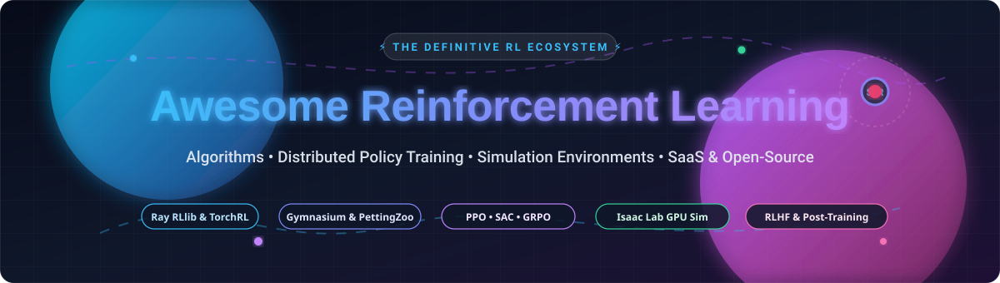
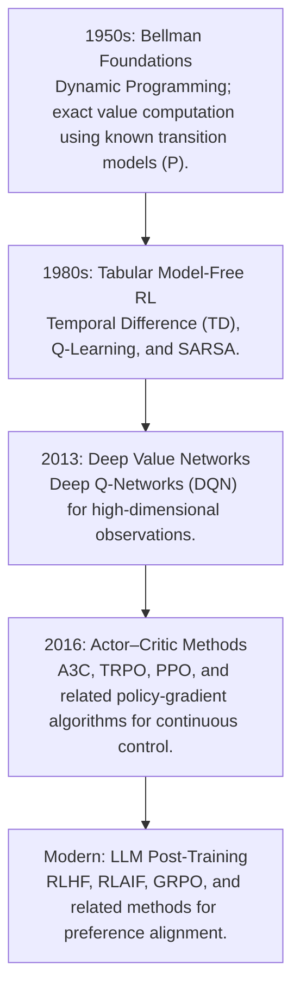
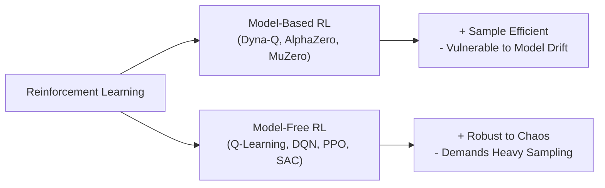
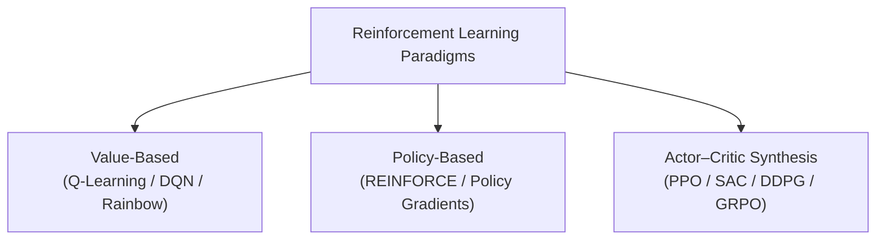
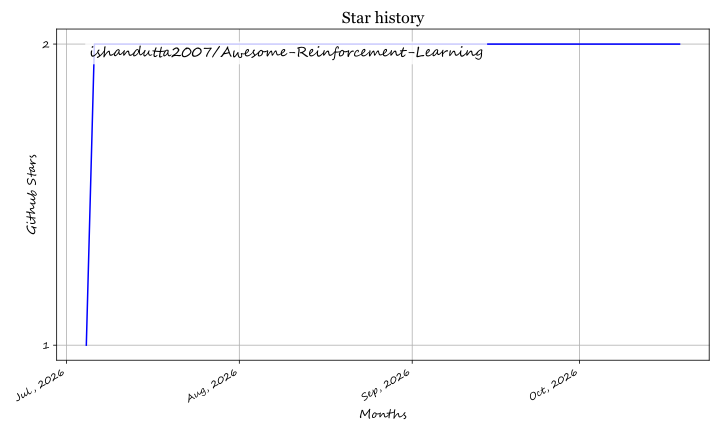

<div align="center">
  
</div>

# 🚀 Awesome-Reinforcement-Learning 🧠
## 🤖 The Reinforcement Learning (RL) Paradigm, Tooling Ecosystem & Architecture Map 🗺️

<p align="center">
<a href="https://github.com/ishandutta2007/Awesome-Awesome-Awesome"></a><a href="https://discord.gg/jc4xtF58Ve"></a><a href="https://github.com/ishandutta2007/Awesome-Reinforcement-Learning/stargazers"></a><a href="https://github.com/ishandutta2007/Awesome-Reinforcement-Learning/network/members"></a><a href="LICENSE"></a><a href="https://github.com/ishandutta2007/Awesome-Reinforcement-Learning/pulls"></a><a href="https://github.com/ishandutta2007"></a>
</p>

> 🔍 **SEO Keywords:** Reinforcement Learning, Deep Reinforcement Learning, DRL, Q-Learning, Deep Q-Networks (DQN), Proximal Policy Optimization (PPO), Group Relative Policy Optimization (GRPO), Soft Actor-Critic (SAC), Ray RLlib, Stable-Baselines3, Gymnasium, TorchRL, Isaac Lab, Multi-Agent RL (MARL), RLHF, LLM Post-Training, Markov Decision Process (MDP), PyTorch RL, Autonomous Control, Robotics Simulation.

---

### 📖 Executive Overview

**Reinforcement Learning (RL)** focuses on training autonomous computational agents to maximize cumulative scalar rewards within stochastic, dynamic environments through sequential trial-and-error interactions. Guided by environmental feedback rather than explicit supervised label matrices, RL constructs mapping functions directly from continuous or discrete observation spaces to optimal policy actions.

This repository serves as a **definitive, production-ready encyclopedia and curated directory**—spanning fundamental mathematical formulations, historical algorithmic evolution, reference PyTorch architectures, market dynamics, enterprise SaaS platforms, and open-source ecosystems.

---

## 📑 Table of Contents

- 📅 [The Evolutionary Timeline](#-the-evolutionary-timeline)
- 🧭 [Algorithmic Taxonomy & Evolution](#-algorithmic-taxonomy--evolution)
  - [1. Model-Based vs. Model-Free Architectures](#-1-model-based-vs-model-free-architectures)
  - [2. Value-Based, Policy-Based, and Actor-Critic Methods](#-2-value-based-policy-based-and-actor-critic-methods)
- 🧮 [Mathematical Foundations (The MDP)](#-mathematical-foundations-the-mdp-)
- 🌍 [Real-World Applications by Implementation Domain](#-real-world-applications-by-implementation-domain-)
- 💻 [Complete Reference Implementation: Actor-Critic Setup (PyTorch)](#-complete-reference-implementation-actor-critic-setup-pytorch)
- 🌐 [Sector Overview & Market Dynamics](#-sector-overview--market-dynamics)
- 🏢 [SaaS & Hosted Platforms (Ranked by Scale)](#-saas--hosted-platforms-ranked-by-scale)
- 📦 [Open-Source GitHub Projects (Ranked by Stars)](#-open-source-github-projects-ranked-by-stars)
- 🤝 [How to Contribute](#-how-to-contribute)
- ⚖️ [Disclaimer](#-disclaimer)
- 📈 [Star History](#-star-history)
- 💖 [Support & Sponsoring](#-support--sponsoring)

---

## 📅 The Evolutionary Timeline

The evolutionary progression of reinforcement learning transitions from theoretical statistical control equations to massively parallel GPU-simulated multi-agent clusters and frontier LLM alignment paradigms.



---

## 🧭 Deep Dive: Algorithmic Taxonomy & Evolution

### 🏛️ 1. Model-Based vs. Model-Free Architectures

The foundational structural fork in reinforcement learning relies on whether the agent constructs or assumes an explicit predictive model of environmental physics.



#### 🔮 Model-Based RL (e.g., Dyna-Q, AlphaZero, MuZero)
The agent leverages or learns a transition function $P(s' \mid s, a)$ and a scalar reward function $R(s, a)$ to simulate future trajectories internally before committing physical actions.
*   **Key Advantage:** Highly sample-efficient; computes forward paths through Monte Carlo Tree Search (MCTS) or trajectory rollouts.
*   **Vulnerability:** Susceptible to compounding model errors; if the internal physics simulation drifts from reality, policy decisions degrade catastrophically.

#### ⚡ Model-Free RL (e.g., Q-Learning, DQN, PPO, SAC)
The agent bypasses environment physics reconstruction, optimizing behaviors directly from empirical samples gathered through continuous trial interactions.
*   **Key Advantage:** Robust and flexible across chaotic, non-linear environments where analytical physical modeling is computationally intractable.
*   **Vulnerability:** Demands substantial data throughput, requiring hundreds of thousands to millions of interaction steps to converge.

---

### ⚖️ 2. Value-Based, Policy-Based, and Actor-Critic Methods



#### 📊 Value-Based Methods (Tracking Expected Gains)
Value-based algorithms calculate the expected long-term return for each state or state-action pair, deriving optimal actions greedily by selecting inputs that yield maximum expected utility.
*   **Core Bellman Update Equation (Tabular Q-Learning):**
    $$Q(s, a) \leftarrow Q(s, a) + \alpha \left[ R(s, a) + \gamma \max_{a'} Q(s', a') - Q(s, a) \right]$$
*   **Deep Q-Networks (DQN, 2015):** Replaced discrete tabular arrays with deep convolutional backbones. Incorporated an **Experience Replay Buffer** to break temporal sample correlation and an asynchronous **Target Network** to prevent gradient divergence during updates.

#### 🎯 Policy-Based Methods (Direct Mapping)
Policy gradient approaches bypass value matrices, directly parameterizing policy network distributions ($\pi_\theta(a \mid s)$) to emit action probabilities.
*   **Core Objective Equation (REINFORCE):**
    $$\nabla_\theta J(\theta) = \mathbb{E} \left[ \nabla_\theta \log \pi_\theta(a \mid s) \cdot G_t \right]$$
    *(Where $G_t$ represents the discounted cumulative return of the sampled rollout trajectory).*
*   **Limitation:** High variance in gradient estimation; extreme trajectory outcomes can cause policy oscillations.

#### 🎭 Actor-Critic Implementations (The Modern Synthesis)
Synthesizes the strengths of value and policy frameworks into an asymmetric two-part architecture:
1.  **The Actor:** Governs the policy distribution network $\pi_\theta(a \mid s)$, selecting actions based on observed states.
2.  **The Critic:** Approximates state-value baselines $V_\phi(s)$, evaluating action quality to determine the **Advantage Score**:
    $$A(s, a) = Q(s, a) - V(s)$$
*   **Proximal Policy Optimization (PPO, 2017):** Stabilizes policy updates by enforcing a probability ratio clipping constraint within $[1-\epsilon, 1+\epsilon]$, eliminating catastrophic policy collapse.
*   **Group Relative Policy Optimization (GRPO, 2024–2026):** Optimizes LLM reasoning and post-training by eliminating the separate Critic neural network. GRPO samples a candidate group of completions for a prompt and evaluates relative advantages across the cohort, cutting GPU memory overhead by over 50%.

---

## 🧮 Mathematical Foundations (The MDP) 🎲

Reinforcement learning formulations map directly to the formal mathematical framework of a **Markov Decision Process (MDP)**, founded upon the Markov Property: *The future state depends exclusively upon the current state and action, independent of preceding history.*

$$\mathbb{P}(S_{t+1}=s' \mid S_t=s, A_t=a, S_{t-1}=s_{t-1}, \dots) = \mathbb{P}(S_{t+1}=s' \mid S_t=s, A_t=a)$$

An MDP is formally defined by the 5-tuple: $\langle \mathcal{S}, \mathcal{A}, \mathcal{P}, \mathcal{R}, \gamma \rangle$:
*   **$\mathcal{S}$ (State Space):** The set of all valid environmental states.
*   **$\mathcal{A}$ (Action Space):** The set of all possible discrete or continuous action vectors available to the agent.
*   **$\mathcal{P}$ (Transition Probability):** The transition function $\mathcal{P}(s' \mid s, a) = \mathbb{P}(S_{t+1}=s' \mid S_t=s, A_t=a)$.
*   **$\mathcal{R}$ (Reward Function):** The expected scalar feedback $\mathcal{R}(s, a) = \mathbb{E}[R_{t+1} \mid S_t=s, A_t=a]$.
*   **$\gamma$ (Discount Factor):** Temporal weight parameter ($0 \le \gamma < 1$) balancing immediate rewards against deferred long-term payoffs.

---

## 🌍 Real-World Applications by Implementation Domain 🚀

*   🤖 **Generative AI Alignment & Reasoning (LLMs):** Fine-tuning foundation models via PPO, DPO, and GRPO based on human feedback tokens (RLHF/RLAIF) to resolve reasoning bugs, minimize hallucinations, and strengthen multi-turn instruction following.
*   🦾 **Industrial Robotics & Continuous Locomotion:** Leveraging Soft Actor-Critic (SAC) and PPO inside GPU-parallel physics engines (Isaac Sim) to teach multi-joint robotic arms and quadrupedal platforms how to traverse unmapped terrains.
*   📈 **Algorithmic Trading & Portfolio Management:** Deploying Deep Deterministic Policy Gradients (DDPG) to dynamically rebalance capital allocations according to reward functions tied to Sharpe ratios and drawdown bounds.
*   🏭 **Logistics & Automated Warehousing:** Utilizing Multi-Agent RL (MARL) algorithms to route swarms of autonomous mobile robots (AMRs) through high-density fulfillment centers without deadlocks.
*   ⚡ **Grid Management & Energy Optimization:** Applying model-predictive RL controllers to modulate hyper-scale data center HVAC chilling loops, achieving 30%+ energy reductions.

---

## 💻 Complete Reference Implementation: Actor-Critic Setup (PyTorch)

A self-contained, modular reference implementation of an Actor-Critic architecture in PyTorch demonstrating shared representations, advantage computation, and policy gradient loss updates:

```python
import torch
import torch.nn as nn
import torch.optim as optim
from torch.distributions import Categorical

class ActorCriticNetwork(nn.Module):
    """
    Two-headed Actor-Critic neural network architecture with shared representation backbone.
    """
    def __init__(self, state_dim: int, action_dim: int):
        super(ActorCriticNetwork, self).__init__()
        # Shared feature extraction backbone
        self.shared_backbone = nn.Sequential(
            nn.Linear(state_dim, 128),
            nn.ReLU(),
            nn.Linear(128, 128),
            nn.ReLU()
        )
        
        # 1. Actor Head: Outputs action logits / probabilities
        self.actor_head = nn.Sequential(
            nn.Linear(128, action_dim),
            nn.Softmax(dim=-1)
        )
        
        # 2. Critic Head: Evaluates expected state value V(s)
        self.critic_head = nn.Linear(128, 1)

    def forward(self, state: torch.Tensor):
        features = self.shared_backbone(state)
        action_probs = self.actor_head(features)
        state_value = self.critic_head(features)
        return Categorical(action_probs), state_value

def optimize_step(
    network: nn.Module,
    optimizer: optim.Optimizer,
    state: list,
    action: int,
    reward: float,
    next_state: list,
    done: bool,
    gamma: float = 0.99
) -> float:
    """
    Performs a single temporal difference policy optimization step.
    """
    state_tensor = torch.FloatTensor(state)
    next_state_tensor = torch.FloatTensor(next_state)
    
    # Forward pass
    dist, value = network(state_tensor)
    _, next_value = network(next_state_tensor)
    
    # Compute TD Target and Advantage: A(s,a) = R + gamma * V(s') - V(s)
    td_target = reward + (gamma * next_value.item() * (1.0 - float(done)))
    advantage = td_target - value.item()
    
    # Policy loss (Actor) and Value regression loss (Critic)
    actor_loss = -dist.log_prob(torch.tensor(action)) * advantage
    critic_loss = nn.functional.mse_loss(value, torch.tensor([[td_target]], dtype=torch.float32))
    total_loss = actor_loss + 0.5 * critic_loss
    
    # Backpropagation
    optimizer.zero_grad()
    total_loss.backward()
    optimizer.step()
    
    return total_loss.item()
```

---

## 🌐 Sector Overview & Market Dynamics

The global **Reinforcement Learning market** is projected to grow from **$16.2 billion in 2026** to over **$46.4 billion by 2030**, advancing at an aggressive **CAGR of ~28.1% to 31.6%**, catalyzed by generative AI post-training (RLHF/RLAIF/GRPO), autonomous vehicle stacks, and industrial robotics automation.

Market concentration exhibits a **moderately fragmented yet deeply polarized landscape**: core distributed training compute and cloud hosting are heavily concentrated among hyperscale cloud providers and unified platform giants (Microsoft, AWS, Databricks), while specialized RL tools—such as physics simulators, experiment observability engines, and modular research algorithm frameworks—remain vibrant, specialized, and moderately fragmented across fast-moving startups and open-source foundations.

---

## 🏢 SaaS & Hosted Platforms (Ranked by Scale)

The table below compiles commercial SaaS products and hosted ML platforms optimized for reinforcement learning, distributed policy rollouts, and experiment tracking, **sorted descending by company size (valuation / revenue)**:

| 🏢 Platform / Product | 📊 Company Size (Valuation / Revenue) | 🏷️ Starting Price | 🎁 Free Tier / Trial Limits | 🧠 Core RL Capabilities |
| :--- | :--- | :--- | :--- | :--- |
| **[Azure Machine Learning](https://azure.microsoft.com/en-us/products/machine-learning/)** | **Microsoft**<br/>• Market Cap: **~$3.1 Trillion**<br/>• Annual Revenue: **$245B+** | **$0.096/hr**<br/>*(Compute Standard_D2s_v3; Studio software management layer is $0)* | **$200 free credits** for 30 days + 12 months access to popular free services; basic ML Studio workspace features are free forever | Managed enterprise cloud ML platform with Ray on Azure ML cluster scaling, automated hyperparameter sweep pipelines, and MLflow registry. |
| **[AWS SageMaker RL](https://aws.amazon.com/sagemaker/)** | **Amazon / AWS**<br/>• Market Cap: **~$2.1 Trillion**<br/>• Annual Revenue: **$620B+** | **$0.05/hr**<br/>*(Notebooks on ml.t3.medium)* / **$0.115/hr** *(Training on ml.m5.large)* | **60-day free trial** with 250 hrs/month of ml.t3.medium notebooks, 50 hrs/month of ml.m4.xlarge/m5.xlarge training, and $300 AWS credits | Fully managed RL training suite supporting Ray RLlib, Coach, and custom Docker Gym environments with automatic multi-node cluster scaling. |
| **[Databricks](https://www.databricks.com/)** | **Databricks**<br/>• Valuation: **~$43 Billion**<br/>• Annual Recurring Revenue: **$2.4B+** | **$0.15/DBU**<br/>*(Databricks Unit for Jobs compute tier; Standard interactive compute at $0.40/DBU)* | **Databricks Community Edition free forever** (15 GB single cluster, 1 driver node, no GPU) or **14-day full free trial** with unlimited cloud clusters | Unified data & AI Lakehouse with native Ray integration for large-scale multi-agent RL rollouts, GPU worker nodes, and MLflow tracking. |
| **[Determined AI](https://www.determined.ai/)** | **Hewlett Packard Enterprise (HPE)**<br/>• Market Cap: **~$25 Billion**<br/>• Annual Revenue: **$29.1B** | **$0.35/GPU-hr**<br/>*(Cloud-managed compute)* / **$1,250/node/month** *(Enterprise software license)* | **30-day free trial** on HPE GreenLake / Determined Cloud with access to up to 4 GPUs and full cluster orchestration | Deep learning training orchestration platform featuring distributed policy search, asynchronous hyperparameter tuning (ASHA), and GPU scheduling. |
| **[Weights & Biases (W&B)](https://wandb.ai/)** | **Weights & Biases**<br/>• Valuation: **~$1.25 Billion**<br/>• Capital Raised: **$250M+** | **$50/user/month**<br/>*(Team plan billed annually; or $60/user/month billed monthly)* | **Free forever Personal tier**: 1 user seat, up to 5 model seats/tracks, 100 GB artifact storage, unlimited private runs, and 1 GB/mo Weave traces | Industry-standard developer platform for RL experiment tracking, agent action replay visualization, reward curve tracking, and hyperparameter sweeps. |
| **[Anyscale](https://www.anyscale.com/)** | **Anyscale (Creators of Ray)**<br/>• Valuation: **~$1.0 Billion (Unicorn)**<br/>• Capital Raised: **$260M+** | **$0.0135/hr** *(CPU)* / **$0.5682/hr** *(NVIDIA T4 GPU)* via pay-as-you-go credits | **$100 free starting credits** for all newly registered accounts to launch Ray RLlib clusters, templates, and distributed workers | Managed Ray platform from Ray's creators; scales Ray RLlib from local prototyping to 1,000+ node distributed clusters with zero infrastructure toil. |
| **[Comet ML](https://www.comet.com/)** | **Comet**<br/>• Valuation: **~$300 Million**<br/>• Capital Raised: **$63M+** | **$19/user/month**<br/>*(Pro tier billed annually; or $24/user/month billed monthly)* | **Free forever Individual plan**: 1 user seat, unlimited public and private projects, 10 GB storage, and 100 compute tracking hours/month | Experiment tracking platform offering RL step-level metric logging, reward decomposition graphs, code diffing, and hyperparameter optimization. |
| **[Neptune.ai](https://neptune.ai/)** | **Neptune.ai**<br/>• Valuation: **~$100 Million**<br/>• Capital Raised: **$18M+** | **$49/month**<br/>*(Team plan includes 2 team member seats; additional seats at $25/seat/month)* | **Free forever Individual plan**: 1 user seat, 100 GB artifact storage, 200 compute tracking hours/month, and unlimited projects | Ultra-lightweight experiment registry built for high-throughput metric logging (tens of millions of RL time-step points without UI lag). |

---

## 📦 Open-Source GitHub Projects (Ranked by Stars)

The most influential open-source reinforcement learning repositories, libraries, physics simulators, and environment suites, **sorted descending by active GitHub Stars_Count**:

### 1. 🥇 [Ray (RLlib)](https://github.com/ray-project/ray) [](https://github.com/ray-project/ray/stargazers)
* **Description:** Unified distributed execution framework powering **Ray RLlib**, the industry standard for production-grade, distributed reinforcement learning.
* **Key Features:** Native support for multi-agent RL (MARL), offline RL, external simulator bindings, and elastic scaling from single laptops to 10,000+ CPU/GPU nodes via `LearnerGroup` and `EnvRunnerGroup` APIs.
* **License:** Apache-2.0

### 2. 🥈 [OpenAI Gym](https://github.com/openai/gym) [](https://github.com/openai/gym/stargazers)
* **Description:** The historic foundational API that established standardized interfaces between reinforcement learning algorithms and simulation environments worldwide.
* **Key Features:** Classic control, Atari 2600, 2D Box2D physics, and MuJoCo continuous control suites. *(Maintained successor continued under Farama Gymnasium).*
* **License:** MIT

### 3. 🥉 [Reinforcement Learning Code](https://github.com/dennybritz/reinforcement-learning) [](https://github.com/dennybritz/reinforcement-learning/stargazers)
* **Description:** Denny Britz's acclaimed implementation repository providing clean, pedagogical code companions to Sutton & Barto's RL textbook.
* **Key Features:** Implementations of Dynamic Programming, Monte Carlo, SARSA, Q-Learning, Deep Q-Networks, FA, and Policy Gradient methods.
* **License:** MIT

### 4. 🚀 [TRL (Transformer Reinforcement Learning)](https://github.com/huggingface/trl) [](https://github.com/huggingface/trl/stargazers)
* **Description:** Hugging Face's comprehensive full-stack library for training transformer language models with reinforcement learning techniques.
* **Key Features:** Full implementations of Proximal Policy Optimization (PPO), Direct Preference Optimization (DPO), Group Relative Policy Optimization (GRPO), and Reward Modeling across distributed Accelerate/DeepSpeed clusters.
* **License:** Apache-2.0

### 5. 🏛️ [OpenAI Baselines](https://github.com/openai/baselines) [](https://github.com/openai/baselines/stargazers)
* **Description:** High-quality reference implementations of foundational reinforcement learning algorithms created by OpenAI researchers.
* **Key Features:** Original canonical benchmarks for DQN, TRPO, PPO, DDPG, ACER, and HER.
* **License:** MIT

### 6. ⚡ [Stable-Baselines3](https://github.com/DLR-RM/stable-baselines3) [](https://github.com/DLR-RM/stable-baselines3/stargazers)
* **Description:** Reliable, modular PyTorch implementations of reinforcement learning algorithms built with clean scikit-learn-like design principles.
* **Key Features:** Battle-tested implementations of PPO, SAC, TD3, DQN, and A2C; comprehensive documentation, clean tensor abstractions, and the RL Baselines3 Zoo hyperparameter tuning hub.
* **License:** MIT

### 7. 🏟️ [Gymnasium](https://github.com/Farama-Foundation/Gymnasium) [](https://github.com/Farama-Foundation/Gymnasium/stargazers)
* **Description:** The actively maintained, community-governed standard API for reinforcement learning environments (the official successor fork to OpenAI Gym).
* **Key Features:** Modern step API (`observation, reward, terminated, truncated, info`), vector environments for batched stepping, and modern MuJoCo 3 bindings.
* **License:** MIT

### 8. 🎓 [Spinning Up in Deep RL](https://github.com/openai/spinningup) [](https://github.com/openai/spinningup/stargazers)
* **Description:** OpenAI's educational curriculum and code base designed to take engineers and researchers from zero to deep RL practitioner.
* **Key Features:** Crystal-clear, minimalistic reference code for VPG, TRPO, PPO, DDPG, TD3, and SAC alongside exhaustive mathematical explanations.
* **License:** MIT

### 9. 🥋 [Tianshou](https://github.com/thu-ml/tianshou) [](https://github.com/thu-ml/tianshou/stargazers)
* **Description:** Highly modular, lightning-fast PyTorch deep reinforcement learning library based on pure vectorized environment sampling.
* **Key Features:** Supports 30+ algorithms across model-free, model-based, multi-agent, and offline RL with modular policy abstractions and high-speed prioritized experience replay buffers.
* **License:** MIT

### 10. 🧹 [CleanRL](https://github.com/vwxyzjn/cleanrl) [](https://github.com/vwxyzjn/cleanrl/stargazers)
* **Description:** High-quality, self-contained single-file implementations of deep reinforcement learning algorithms with zero hidden abstractions.
* **Key Features:** Every algorithm variant exists in a standalone single file (~300–400 lines) with complete logging, hyperparameter tracking, and Weights & Biases telemetry.
* **License:** MIT

### 11. 🦾 [Isaac Lab](https://github.com/isaac-sim/IsaacLab) [](https://github.com/isaac-sim/IsaacLab/stargazers)
* **Description:** NVIDIA's unified, modular GPU-accelerated framework for robot learning and reinforcement learning simulation built on Isaac Sim / Omniverse.
* **Key Features:** Massive parallel physics stepping (tens of thousands of concurrent robot instances on a single RTX 4090/A100 GPU); direct integrations with RL-Games, RSL-RL, skrl, and Stable-Baselines3.
* **License:** BSD-3-Clause

### 12. 🎲 [OpenSpiel](https://github.com/google-deepmind/open_spiel) [](https://github.com/google-deepmind/open_spiel/stargazers)
* **Description:** Google DeepMind's comprehensive collection of environments and algorithms for research in multi-agent reinforcement learning and game theory.
* **Key Features:** Extensive suite of cooperative, zero-sum, and general-sum games (Chess, Go, Poker, Hanabi, Backgammon) with Monte Carlo Tree Search, CFR, and AlphaZero algorithms.
* **License:** Apache-2.0

### 13. 📈 [ElegantRL](https://github.com/AI4Finance-Foundation/ElegantRL) [](https://github.com/AI4Finance-Foundation/ElegantRL/stargazers)
* **Description:** Cloud-native, massively parallel deep reinforcement learning framework with lightweight, highly readable core architectures (<1,000 lines).
* **Key Features:** Multiprocessing actor-critic worker pipelines, Isaac Gym parallel environment compatibility, and applied quantitative finance toolkits.
* **License:** Apache-2.0

### 14. 🔬 [Acme](https://github.com/google-deepmind/acme) [](https://github.com/google-deepmind/acme/stargazers)
* **Description:** Google DeepMind's research framework providing building blocks for constructing scalable, reproducible reinforcement learning agents.
* **Key Features:** Explicit separation of Actor and Learner components, enabling identical agent code to execute on single local laptops or across distributed cluster topologies with JAX and TensorFlow.
* **License:** Apache-2.0

### 15. 🏡 [Habitat-Sim](https://github.com/facebookresearch/habitat-sim) [](https://github.com/facebookresearch/habitat-sim/stargazers)
* **Description:** Meta AI Research's high-performance 3D simulator for embodied AI and visual navigation reinforcement learning.
* **Key Features:** Renders photorealistic 3D indoor scenes (Matterport3D, Gibson) at several thousand frames per second per GPU core, enabling rapid training of sensory-motor policies.
* **License:** MIT

### 16. 🔄 [ReAgent (Horizon)](https://github.com/facebookresearch/ReAgent) [](https://github.com/facebookresearch/ReAgent/stargazers)
* **Description:** Meta's applied open-source platform for reasoning systems and discrete/continuous offline reinforcement learning.
* **Key Features:** Specialized in production recommendation systems, automated push notification delivery, and off-policy evaluation (OPE) on counterfactual data.
* **License:** BSD-3-Clause

### 17. 🔥 [TorchRL](https://github.com/pytorch/rl) [](https://github.com/pytorch/rl/stargazers)
* **Description:** Official PyTorch-native reinforcement learning library built around explicit `TensorDict` data structures and high-performance C++ execution kernels.
* **Key Features:** Modular actors, critics, replay buffers, distributed collectors, and loss operators for model-free, model-based, multi-agent, and decision-transformer architectures.
* **License:** MIT

### 18. 🐾 [PettingZoo](https://github.com/Farama-Foundation/PettingZoo) [](https://github.com/Farama-Foundation/PettingZoo/stargazers)
* **Description:** The Farama Foundation's multi-agent counterpart to Gymnasium, providing standardized APIs for multi-agent reinforcement learning.
* **Key Features:** Agent-Environment Cycle (AEC) and Parallel environment interfaces covering classical board games, multi-player Atari, cooperative particle simulations, and swarm robotics.
* **License:** MIT

### 19. 🤖 [Gymnasium-Robotics](https://github.com/Farama-Foundation/Gymnasium-Robotics) [](https://github.com/Farama-Foundation/Gymnasium-Robotics/stargazers)
* **Description:** Standardized continuous control robotics environments for Gymnasium with physics simulations implemented in MuJoCo.
* **Key Features:** Fetch manipulation, Shadow Dexterous Hand, Franka Emika Panda, and Adroit manipulation tasks with goal-conditioned RL baselines.
* **License:** MIT

### 20. 🦾 [MetaWorld](https://github.com/Farama-Foundation/Metaworld) [](https://github.com/Farama-Foundation/Metaworld/stargazers)
* **Description:** Benchmark environment suite for meta-reinforcement learning and multi-task robotic manipulation.
* **Key Features:** 50 distinct robotic manipulation tasks (MT10, MT50, ML10, ML45) designed to test policy generalization across diverse physical interaction paradigms.
* **License:** MIT

### 21. 💾 [Minari](https://github.com/Farama-Foundation/Minari) [](https://github.com/Farama-Foundation/Minari/stargazers)
* **Description:** Standardized library and dataset repository for offline reinforcement learning (the modern successor to D4RL).
* **Key Features:** HDF5-based dataset storage, dataset creation pipelines from Gymnasium observation streams, and reproducibility testing suites.
* **License:** Apache-2.0

### 22. 🧩 [Jumanji](https://github.com/instadeepai/jumanji) [](https://github.com/instadeepai/jumanji/stargazers)
* **Description:** InstaDeep's suite of hardware-accelerated, scalable reinforcement learning environments written natively in JAX.
* **Key Features:** 22+ environments ranging from combinatorial optimization (TSP, Knapsack, Bin Packing) to complex games, capable of auto-vectorization (`jax.vmap`) and JIT compilation on TPUs and GPUs.
* **License:** Apache-2.0

---

## 🤝 How to Contribute

Contributions from researchers, engineers, and maintainers are enthusiastically welcomed!

1. 🍴 **Fork the repository** on GitHub.
2. 🌿 **Create a descriptive feature branch** (`git checkout -b feature/add-new-rl-tool`).
3. ✍️ **Add your entry** following the tabular format for SaaS platforms or the ranked list format for open-source tools with appropriate badges.
4. 🧪 **Ensure all links and references are valid** and factual.
5. 🚀 **Submit a Pull Request** with a concise summary of changes.

---

## ⚖️ Disclaimer

* This repository is an independently curated educational and technical index. Product names, logos, and brands belong to their respective copyright holders.
* Reinforcement learning frameworks vary substantially in sample efficiency, distributed scaling models, and implementation complexity.
* **Ray RLlib** is optimized for elastic, distributed production workloads; **Stable-Baselines3** is ideal for clean single-agent PyTorch research; **Isaac Lab** leads massively parallel GPU robotics simulation; **Gymnasium & PettingZoo** provide the gold-standard environment interfaces.
* Always evaluate your hardware constraints, algorithm requirements, and environment complexity when selecting an RL stack.

---

## 📈 Star History

[](https://star-history.dera.page/#ishandutta2007/Awesome-Reinforcement-Learning&type=date&legend=top-left)

---

## 💖 Support & Sponsoring

Thank you for visiting and supporting **Awesome Reinforcement Learning**! If you find this curated reference map and tooling guide useful in your academic research, industrial projects, or learning path:

* ⭐ **Star this repository** to bookmark it and help other researchers discover it.
* 🍴 **Fork the repo** to maintain your personal reference and contribute enhancements back.
* 📢 **Share it** with your peers, AI labs, and robotics communities.
* ☕ **Sponsor the maintainer**: Support continuous research curation, tool tracking, and updates via the [GitHub Sponsor Dashboard](https://github.com/sponsors/ishandutta2007).

## Star History

<a href="https://star-history.com/#ishandutta2007/Awesome-Reinforcement-Learning&Timeline" align="center">
  <picture>
    <source media="(prefers-color-scheme: dark)" srcset="assets/ishandutta2007_Awesome-Reinforcement-Learning_growth.svg">
    
  </picture>
</a>
